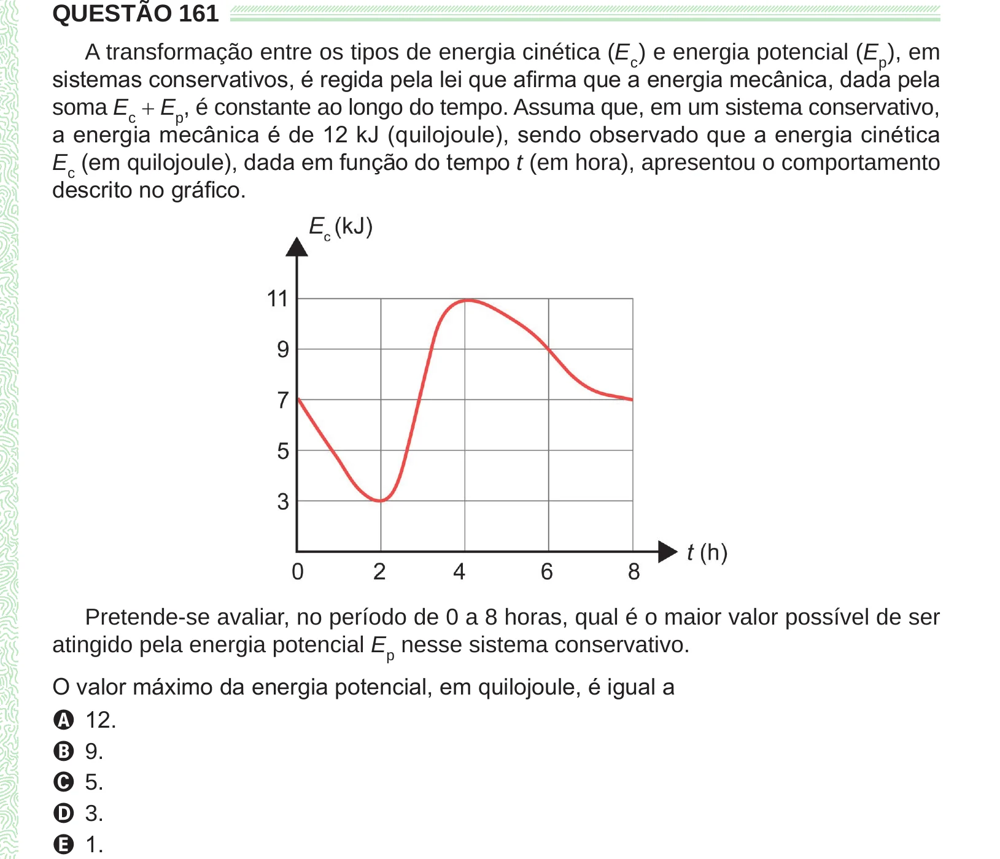

Texto extraído (pode conter ruído)

QUESTÃO 161  
A transformação entre os tipos de energia cinética (E c ) e energia potencial (E p ), em  
sistemas conservativos, é regida pela lei que afirma que a energia mecânica, dada pela  
soma E c + E p , é constante ao longo do tempo. Assuma que, em um sistema conservativo,  
a energia mecânica é de 12 kJ (quilojoule), sendo observado que a energia cinética  
E c (em quilojoule), dada em função do tempo t (em hora), apresentou o comportamento  
descrito no gráfico.  
Pretende-se avaliar, no período de 0 a 8 horas, qual é o maior valor possível de ser  
atingido pela energia potencial E p nesse sistema conservativo.  
O valor máximo da energia potencial, em quilojoule, é igual a  
A 12.  
B 9.  
C 5.  
D 3.  
E 1.

