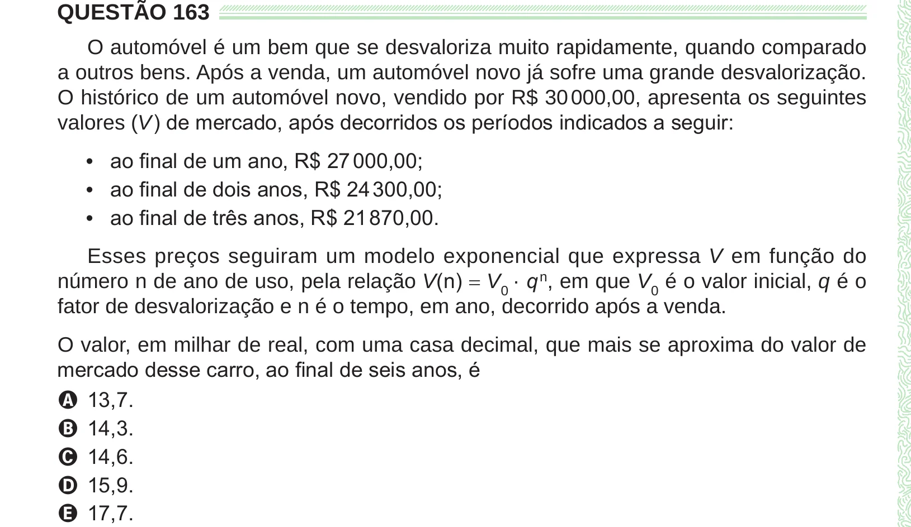

Texto extraído (pode conter ruído)

QUESTÃO 163  
O automóvel é um bem que se desvaloriza muito rapidamente, quando comparado  
a outros bens. Após a venda, um automóvel novo já sofre uma grande desvalorização.  
O histórico de um automóvel novo, vendido por R$ 30 000,00, apresenta os seguintes  
valores (V ) de mercado, após decorridos os períodos indicados a seguir:  
• ao final de um ano, R$ 27 000,00;  
• ao final de dois anos, R$ 24 300,00;  
• ao final de três anos, R$ 21 870,00.  
Esses preços seguiram um modelo exponencial que expressa V em função do  
número n de ano de uso, pela relação V(n) = V 0 · q n , em que V 0 é o valor inicial, q é o  
fator de desvalorização e n é o tempo, em ano, decorrido após a venda.  
O valor, em milhar de real, com uma casa decimal, que mais se aproxima do valor de  
mercado desse carro, ao final de seis anos, é  
A 13,7.  
B 14,3.  
C 14,6.  
D 15,9.  
E 17,7.

