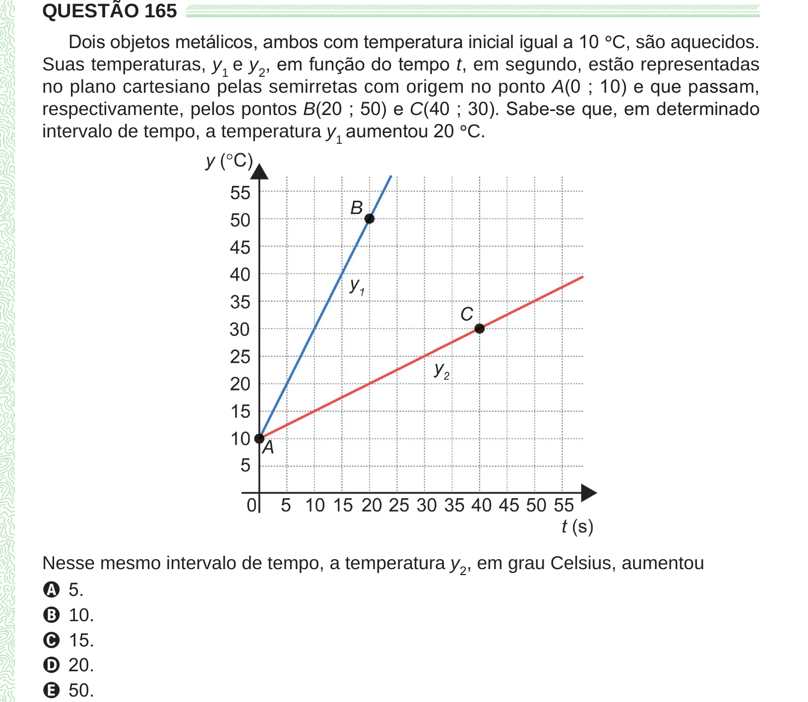

Texto extraído (pode conter ruído)

QUESTÃO 165  
Dois objetos metálicos, ambos com temperatura inicial igual a 10 ° C, são aquecidos.  
Suas temperaturas, y 1 e y 2 , em função do tempo t, em segundo, estão representadas  
no plano cartesiano pelas semirretas com origem no ponto A(0 ; 10) e que passam,  
respectivamente, pelos pontos B(20 ; 50) e C(40 ; 30). Sabe-se que, em determinado  
intervalo de tempo, a temperatura y 1 aumentou 20 ° C.  
Nesse mesmo intervalo de tempo, a temperatura y 2 , em grau Celsius, aumentou  
A 5.  
B 10.  
C 15.  
D 20.  
E 50.

