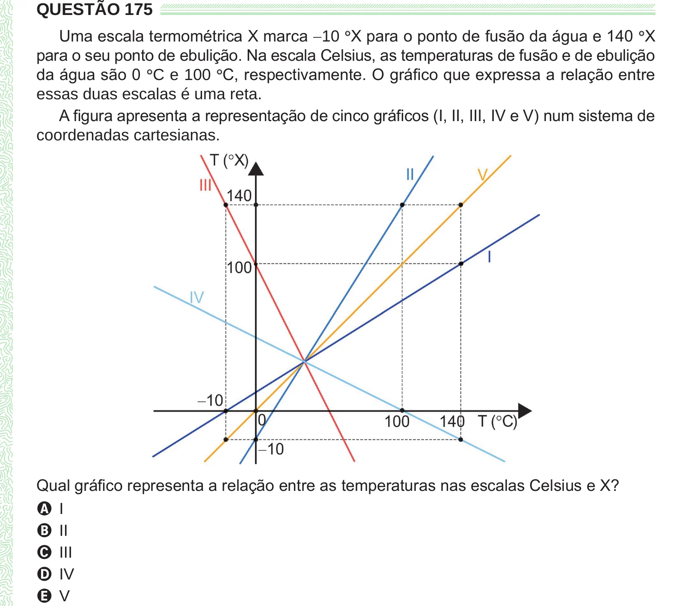

Texto extraído (pode conter ruído)

QUESTÃO 175  
Uma escala termométrica X marca −10 ° X para o ponto de fusão da água e 140 ° X  
para o seu ponto de ebulição. Na escala Celsius, as temperaturas de fusão e de ebulição  
da água são 0 ° C e 100 ° C, respectivamente. O gráfico que expressa a relação entre  
essas duas escalas é uma reta.  
A figura apresenta a representação de cinco gráficos (I, II, III, IV e V) num sistema de  
coordenadas cartesianas.  
Qual gráfico representa a relação entre as temperaturas nas escalas Celsius e X?  
A I  
B II  
C III  
D IV  
E V

