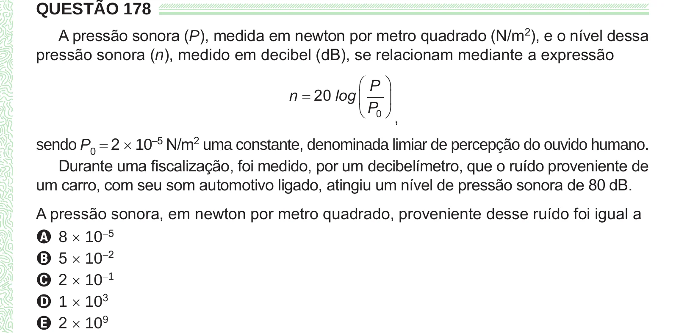

Texto extraído (pode conter ruído)

QUESTÃO 178  
A pressão sonora (P), medida em newton por metro quadrado (N/m 2 ), e o nível dessa  
pressão sonora (n), medido em decibel (dB), se relacionam mediante a expressão  
 P   
n  20 log    
 P 0  ,  
sendo P 0 = 2 × 10 –5 N/m 2 uma constante, denominada limiar de percepção do ouvido humano.  
Durante uma fiscalização, foi medido, por um decibelímetro, que o ruído proveniente de  
um carro, com seu som automotivo ligado, atingiu um nível de pressão sonora de 80 dB.  
A pressão sonora, em newton por metro quadrado, proveniente desse ruído foi igual a  
A 8 × 10 −5  
B 5 × 10 −2  
C 2 × 10 −1  
D 1 × 10 3  
E 2 × 10 9

