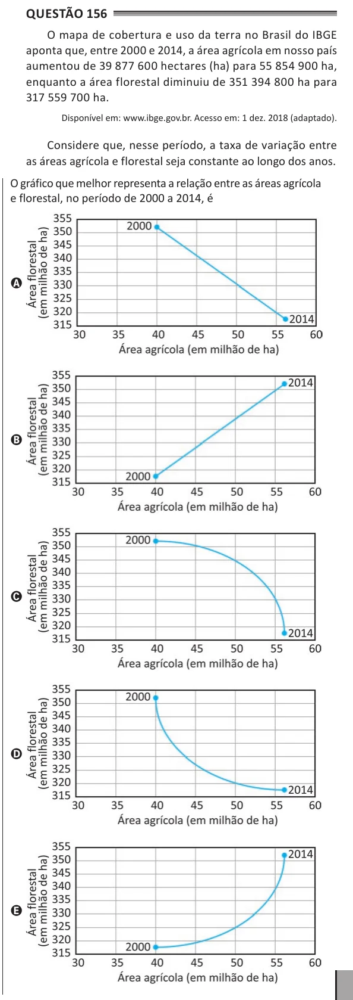

Texto extraído (pode conter ruído)

Questão 156  
O mapa de cobertura e uso da terra no Brasil do IBGE  
aponta que, entre 2000 e 2014, a área agrícola em nosso país  
aumentou de 39 877 600 hectares (ha) para 55 854 900 ha,  
enquanto a área florestal diminuiu de 351 394 800 ha para  
317 559 700 ha.  
Disponível em: www.ibge.gov.br. Acesso em: 1 dez. 2018 (adaptado).  
Considere que, nesse período, a taxa de variação entre  
as áreas agrícola e florestal seja constante ao longo dos anos.  
O gráfico que melhor representa a relação entre as áreas agrícola  
e florestal, no período de 2000 a 2014, é  
A  
B  
C  
D  
E

