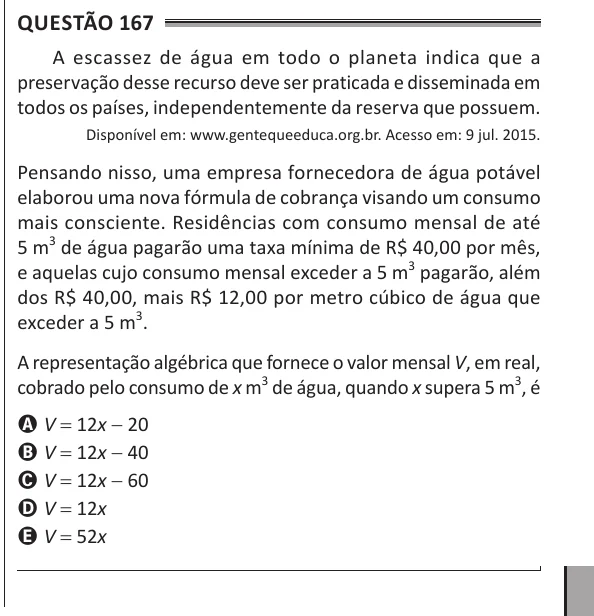

Texto extraído (pode conter ruído)

Questão 167  
A escassez de água em todo o planeta indica que a  
preservação desse recurso deve ser praticada e disseminada em  
todos os países, independentemente da reserva que possuem.  
Disponível em: www.gentequeeduca.org.br. Acesso em: 9 jul. 2015.  
Pensando nisso, uma empresa fornecedora de água potável  
elaborou uma nova fórmula de cobrança visando um consumo  
mais consciente. Residências com consumo mensal de até  
5 m 3 de água pagarão uma taxa mínima de R$ 40,00 por mês,  
e aquelas cujo consumo mensal exceder a 5 m 3 pagarão, além  
dos R$ 40,00, mais R$ 12,00 por metro cúbico de água que  
exceder a 5 m 3 .  
A representação algébrica que fornece o valor mensal V, em real,  
cobrado pelo consumo de x m 3 de água, quando x supera 5 m 3 , é  
A V = 12x - 20  
B V = 12x - 40  
C V = 12x - 60  
D V = 12x  
E V = 52x

