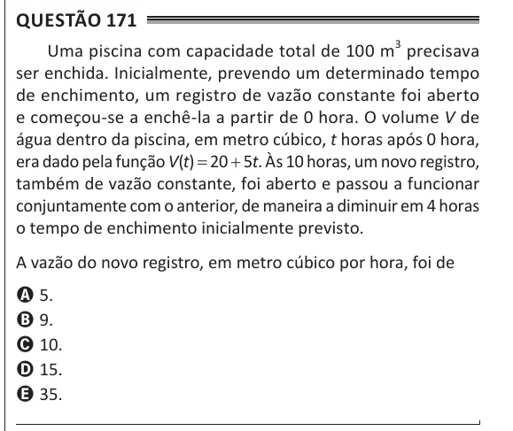

Texto extraído (pode conter ruído)

Questão 171  
Uma piscina com capacidade total de 100 m 3 precisava  
ser enchida. Inicialmente, prevendo um determinado tempo  
de enchimento, um registro de vazão constante foi aberto  
e começou-se a enchê-la a partir de 0 hora. O volume V de  
água dentro da piscina, em metro cúbico, t horas após 0 hora,  
era dado pela função V(t) = 20 + 5t. Às 10 horas, um novo registro,  
também de vazão constante, foi aberto e passou a funcionar  
conjuntamente com o anterior, de maneira a diminuir em 4 horas  
o tempo de enchimento inicialmente previsto.  
A vazão do novo registro, em metro cúbico por hora, foi de  
A 5.  
B 9.  
C 10.  
D 15.  
E 35.

