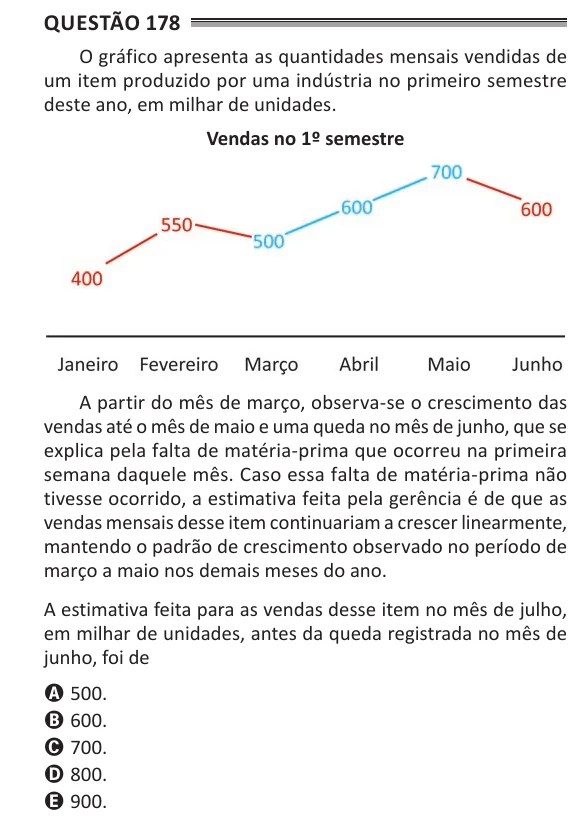

Texto extraído (pode conter ruído)

Questão 178  
O gráfico apresenta as quantidades mensais vendidas de  
um item produzido por uma indústria no primeiro semestre  
deste ano, em milhar de unidades.  
Vendas no 1º semestre  
A partir do mês de março, observa-se o crescimento das  
vendas até o mês de maio e uma queda no mês de junho, que se  
explica pela falta de matéria-prima que ocorreu na primeira  
semana daquele mês. Caso essa falta de matéria-prima não  
tivesse ocorrido, a estimativa feita pela gerência é de que as  
vendas mensais desse item continuariam a crescer linearmente,  
mantendo o padrão de crescimento observado no período de  
março a maio nos demais meses do ano.  
A estimativa feita para as vendas desse item no mês de julho,  
em milhar de unidades, antes da queda registrada no mês de  
junho, foi de  
A 500.  
B 600.  
C 700.  
D 800.  
E 900.

