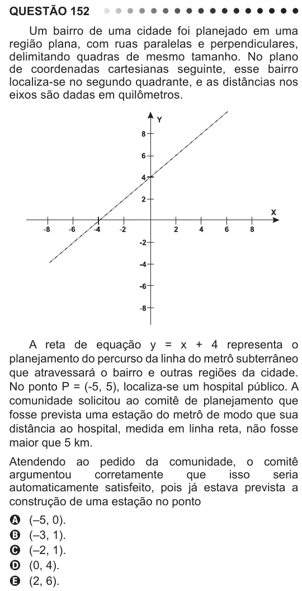

Texto extraído (pode conter ruído)

QUESTÃO 152  
Um bairro de uma cidade foi planejado em uma  
região plana, com ruas paralelas e perpendiculares,  
delimitando quadras de mesmo tamanho. No plano  
de coordenadas cartesianas seguinte, esse bairro  
localiza-se no segundo quadrante, e as distâncias nos  
eixos são dadas em quilômetros.  
A reta de equação y = x + 4 representa o  
planejamento do percurso da linha do metrô subterrâneo  
que atravessará o bairro e outras regiões da cidade.  
No ponto P = (-5, 5), localiza-se um hospital público. A  
comunidade solicitou ao comitê de planejamento que  
fosse prevista uma estação do metrô de modo que sua  
distância ao hospital, medida em linha reta, não fosse  
maior que 5 km.  
Atendendo ao pedido da comunidade, o comitê  
argumentou  
corretamente  
que  
isso  
seria  
automaticamente satisfeito, pois já estava prevista a  
construção de uma estação no ponto  
A  
(–5, 0).  
(–3, 1).  
B  
(–2, 1).  
C  
D  
(0, 4).  
(2, 6).  
E

