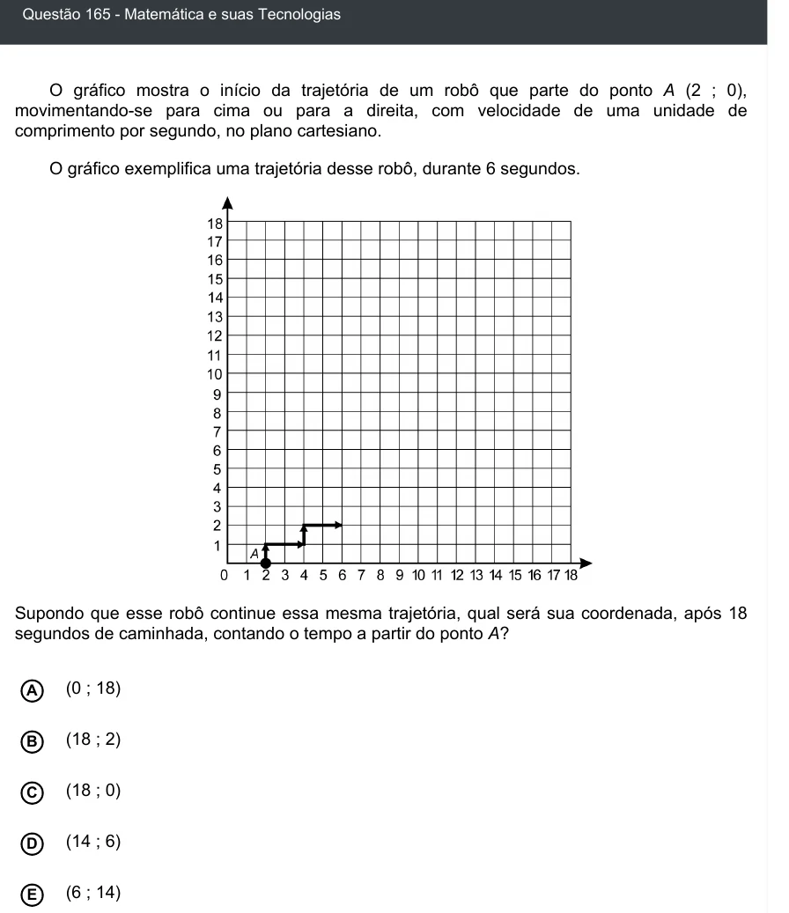

Texto extraído (pode conter ruído)

Questão 165 - Matemática e suas Tecnologias  
O gráfico mostra o início da trajetória de um robô que parte do ponto A (2 ; 0),  
movimentando-se para cima ou para a direita, com velocidade de uma unidade de  
comprimento por segundo, no plano cartesiano.  
O gráfico exemplifica uma trajetória desse robô, durante 6 segundos.  
Supondo que esse robô continue essa mesma trajetória, qual será sua coordenada, após 18  
segundos de caminhada, contando o tempo a partir do ponto A?  
(0 ; 18)  
A  
B  
(18 ; 2)  
(18 ; 0)  
C  
(14 ; 6)  
D  
(6 ; 14)  
E

