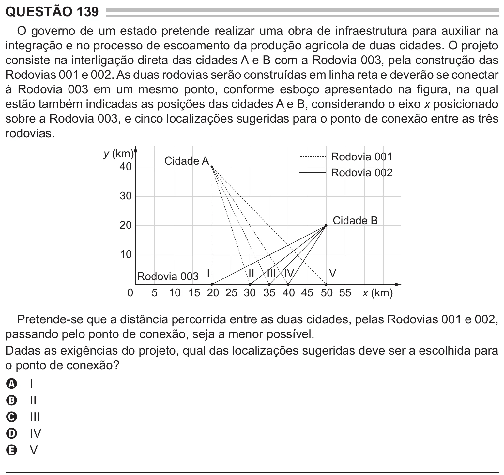

Texto extraído (pode conter ruído)

QUESTÃO 139  
O governo de um estado pretende realizar uma obra de infraestrutura para auxiliar na  
integração e no processo de escoamento da produção agrícola de duas cidades. O projeto  
consiste na interligação direta das cidades A e B com a Rodovia 003, pela construção das  
Rodovias 001 e 002. As duas rodovias serão construídas em linha reta e deverão se conectar  
à Rodovia 003 em um mesmo ponto, conforme esboço apresentado na figura, na qual  
estão também indicadas as posições das cidades A e B, considerando o eixo x posicionado  
sobre a Rodovia 003, e cinco localizações sugeridas para o ponto de conexão entre as três  
rodovias.  
y (km)  
Rodovia 001  
Cidade A  
40  
Rodovia 002  
30  
Cidade B  
20  
10  
Rodovia 003 I  
II III IV  
V  
0  
5 10 15 20 25 30 35 40 45 50 55 x (km)  
Pretende-se que a distância percorrida entre as duas cidades, pelas Rodovias 001 e 002,  
passando pelo ponto de conexão, seja a menor possível.  
Dadas as exigências do projeto, qual das localizações sugeridas deve ser a escolhida para  
o ponto de conexão?  
I  
A  
II  
B  
III  
C  
IV  
D  
V  
E

