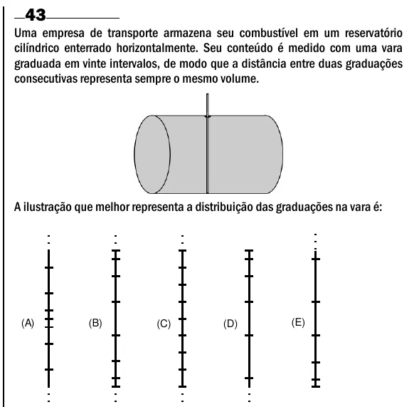

Texto extraído (pode conter ruído)

43  
Uma empresa de transporte armazena seu combustível em um reservatório  
cilíndrico enterrado horizontalmente. Seu conteúdo é medido com uma vara  
graduada em vinte intervalos, de modo que a distância entre duas graduações  
consecutivas representa sempre o mesmo volume.  
A ilustração que melhor representa a distribuição das graduações na vara é:  
(A)  
(B)  
(C)  
(D)  
(E)

