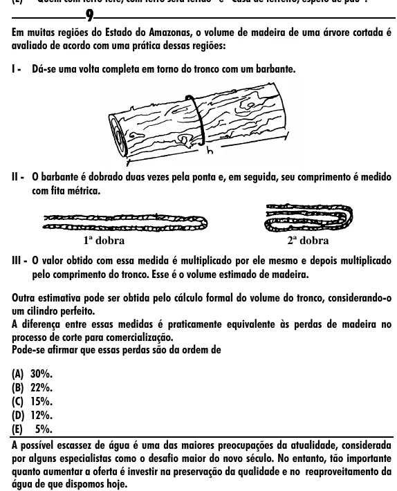

Texto extraído (pode conter ruído)

9  
Em muitas regiões do Estado do Amazonas, o volume de madeira de uma árvore cortada é  
avaliado de acordo com uma prática dessas regiões:  
I - Dá-se uma volta completa em torno do tronco com um barbante.  
II - O barbante é dobrado duas vezes pela ponta e, em seguida, seu comprimento é medido  
com fita métrica.  
1ª dobra  
2ª dobra  
III - O valor obtido com essa medida é multiplicado por ele mesmo e depois multiplicado  
pelo comprimento do tronco. Esse é o volume estimado de madeira.  
Outra estimativa pode ser obtida pelo cálculo formal do volume do tronco, considerando-o  
um cilindro perfeito.  
A diferença entre essas medidas é praticamente equivalente às perdas de madeira no  
processo de corte para comercialização.  
Pode-se afirmar que essas perdas são da ordem de  
(A) 30%.  
(B) 22%.  
(C) 15%.  
(D) 12%.  
(E) 5%.  
A possível escassez de água é uma das maiores preocupações da atualidade, considerada  
por alguns especialistas como o desafio maior do novo século. No entanto, tão importante  
quanto aumentar a oferta é investir na preservação da qualidade e no reaproveitamento da  
água de que dispomos hoje.

