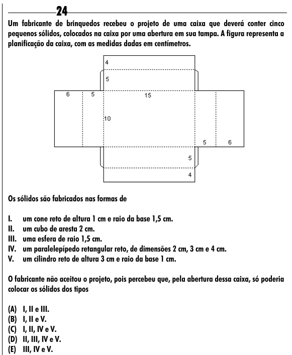

Texto extraído (pode conter ruído)

24  
Um fabricante de brinquedos recebeu o projeto de uma caixa que deverá conter cinco  
pequenos sólidos, colocados na caixa por uma abertura em sua tampa. A figura representa a  
planificação da caixa, com as medidas dadas em centímetros.  
Os sólidos são fabricados nas formas de  
I.  
um cone reto de altura 1 cm e raio da base 1,5 cm.  
II.  
um cubo de aresta 2 cm.  
III.  
uma esfera de raio 1,5 cm.  
IV.  
um paralelepípedo retangular reto, de dimensões 2 cm, 3 cm e 4 cm.  
V.  
um cilindro reto de altura 3 cm e raio da base 1 cm.  
O fabricante não aceitou o projeto, pois percebeu que, pela abertura dessa caixa, só poderia  
colocar os sólidos dos tipos  
(A) I, II e III.  
(B) I, II e V.  
(C) I, II, IV e V.  
(D) II, III, IV e V.  
(E) III, IV e V.

