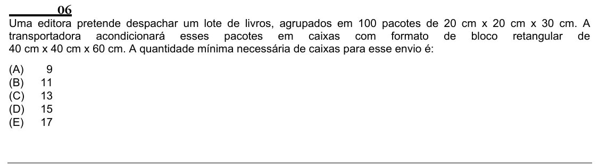

Texto extraído (pode conter ruído)

06  
Uma editora pretende despachar um lote de livros, agrupados em 100 pacotes de 20 cm x 20 cm x 30 cm. A  
transportadora acondicionará esses pacotes em caixas com formato de bloco retangular de  
40 cm x 40 cm x 60 cm. A quantidade mínima necessária de caixas para esse envio é:  
(A)  
9  
(B)  
11  
(C)  
13  
(D)  
15  
(E)  
17

