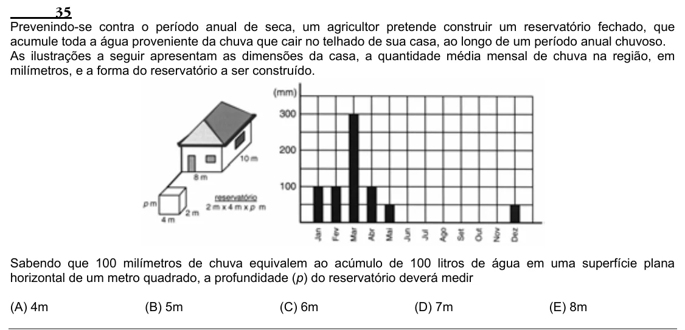

Texto extraído (pode conter ruído)

35  
Prevenindo-se contra o período anual de seca, um agricultor pretende construir um reservatório fechado, que  
acumule toda a água proveniente da chuva que cair no telhado de sua casa, ao longo de um período anual chuvoso.  
As ilustrações a seguir apresentam as dimensões da casa, a quantidade média mensal de chuva na região, em  
milímetros, e a forma do reservatório a ser construído.  
Sabendo que 100 milímetros de chuva equivalem ao acúmulo de 100 litros de água em uma superfície plana  
horizontal de um metro quadrado, a profundidade (p) do reservatório deverá medir  
(A) 4m  
(B) 5m  
(C) 6m  
(D) 7m  
(E) 8m

