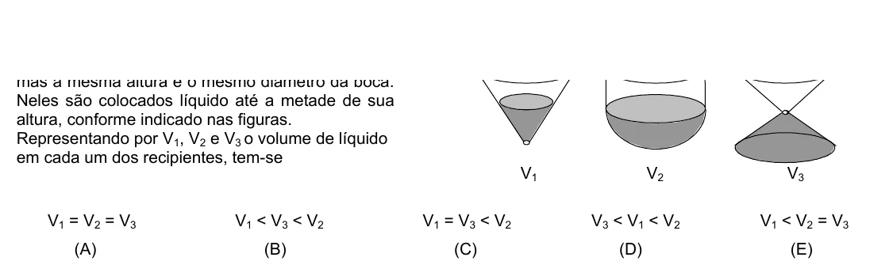

Texto extraído (pode conter ruído)

Neles são colocados líquido até a metade de sua  
altura, conforme indicado nas figuras.  
Representando por V 1 , V 2 e V 3 o volume de líquido  
em cada um dos recipientes, tem-se  
V 1  
V 2  
V 3  
V 1 = V 2 = V 3  
V 1 < V 3 < V 2  
V 1 = V 3 < V 2  
V 3 < V 1 < V 2  
V 1 < V 2 = V 3  
(A)  
(B)  
(C)  
(D)  
(E)

