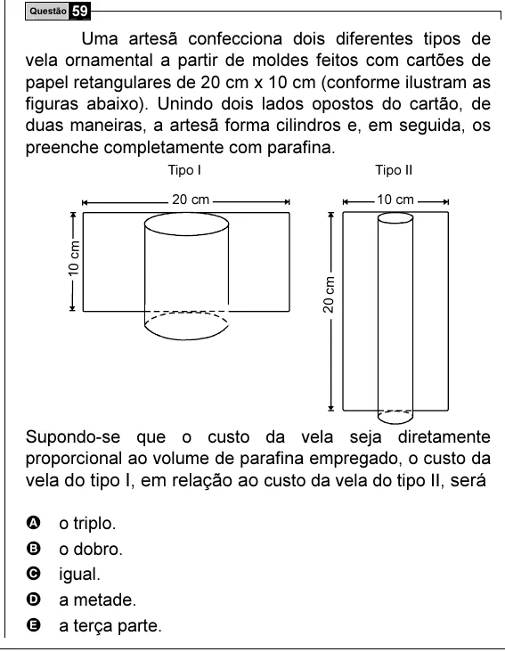

Texto extraído (pode conter ruído)

Questão 59  
Uma artesã confecciona dois diferentes tipos de  
vela ornamental a partir de moldes feitos com cartões de  
papel retangulares de 20 cm x 10 cm (conforme ilustram as  
figuras abaixo). Unindo dois lados opostos do cartão, de  
duas maneiras, a artesã forma cilindros e, em seguida, os  
preenche completamente com parafina.  
Tipo I  
Tipo II  
20 cm  
10 cm  
10 cm  
20 cm  
Supondo-se que o custo da vela seja diretamente  
proporcional ao volume de parafina empregado, o custo da  
vela do tipo I, em relação ao custo da vela do tipo II, será  
A  
o triplo.  
B  
o dobro.  
C  
igual.  
D  
a metade.  
E  
a terça parte.

