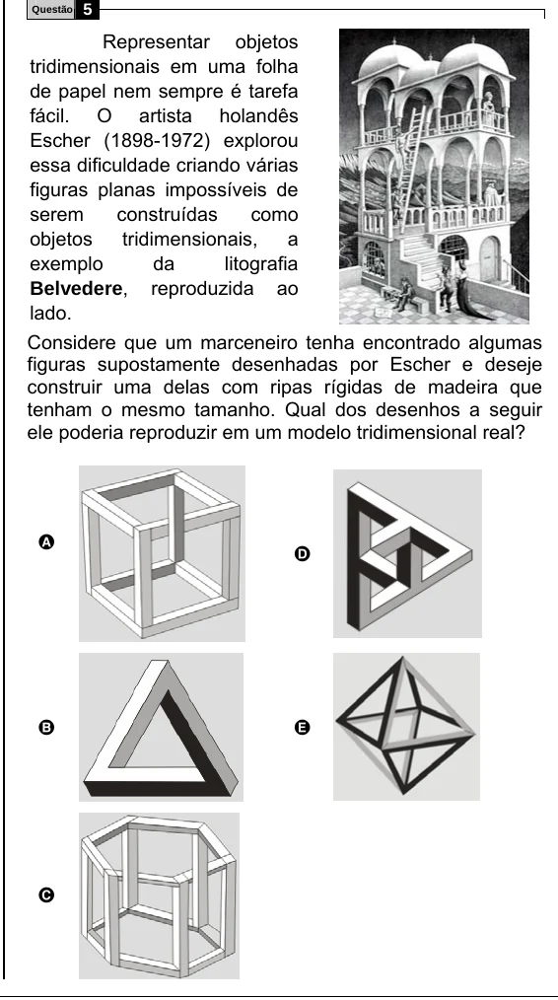

Texto extraído (pode conter ruído)

5  
Questão  
Representar objetos  
tridimensionais em uma folha  
de papel nem sempre é tarefa  
fácil. O artista holandês  
Escher (1898-1972) explorou  
essa dificuldade criando várias  
figuras planas impossíveis de  
serem  
construídas  
como  
objetos  
tridimensionais,  
a  
exemplo  
da  
litografia  
Belvedere, reproduzida ao  
lado.  
Considere que um marceneiro tenha encontrado algumas  
figuras supostamente desenhadas por Escher e deseje  
construir uma delas com ripas rígidas de madeira que  
tenham o mesmo tamanho. Qual dos desenhos a seguir  
ele poderia reproduzir em um modelo tridimensional real?  
A  
D  
B  
E  
C

