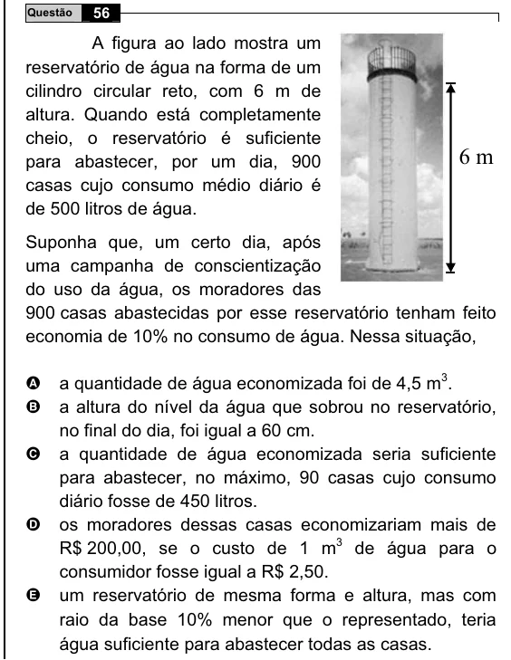

Texto extraído (pode conter ruído)

56  
Questão  
A figura ao lado mostra um  
reservatório de água na forma de um  
cilindro circular reto, com 6 m de  
altura. Quando está completamente  
cheio, o reservatório é suficiente  
para abastecer, por um dia, 900  
6 m  
casas cujo consumo médio diário é  
de 500 litros de água.  
Suponha que, um certo dia, após  
uma campanha de conscientização  
do uso da água, os moradores das  
900 casas abastecidas por esse reservatório tenham feito  
economia de 10% no consumo de água. Nessa situação,  
a quantidade de água economizada foi de 4,5 m 3 .  
A  
B  
a altura do nível da água que sobrou no reservatório,  
no final do dia, foi igual a 60 cm.  
C  
a quantidade de água economizada seria suficiente  
para abastecer, no máximo, 90 casas cujo consumo  
diário fosse de 450 litros.  
os moradores dessas casas economizariam mais de  
D  
R$ 200,00, se o custo de 1 m 3 de água para o  
consumidor fosse igual a R$ 2,50.  
E  
um reservatório de mesma forma e altura, mas com  
raio da base 10% menor que o representado, teria  
água suficiente para abastecer todas as casas.

