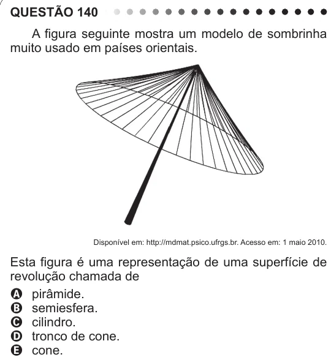

Texto extraído (pode conter ruído)

QUESTÃO 140  
A figura seguinte mostra um modelo de sombrinha  
muito usado em países orientais.  
Disponível em: http://mdmat.psico.ufrgs.br. Acesso em: 1 maio 2010.  
Esta figura é uma representação de uma superfície de  
revolução chamada de  
A pirâmide.  
B semiesfera.  
C cilindro.  
D tronco de cone.  
E cone.

