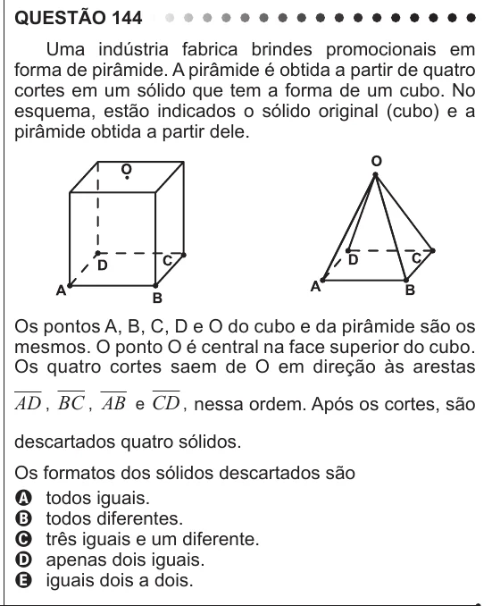

Texto extraído (pode conter ruído)

QUESTÃO 144  
Uma indústria fabrica brindes promocionais em  
forma de pirâmide. A pirâmide é obtida a partir de quatro  
cortes em um sólido que tem a forma de um cubo. No  
esquema, estão indicados o sólido original (cubo) e a  
pirâmide obtida a partir dele.  
Os pontos A, B, C, D e O do cubo e da pirâmide são os  
mesmos. O ponto O é central na face superior do cubo.  
Os quatro cortes saem de O em direção às arestas  
AD , BC , AB e CD , nessa ordem. Após os cortes, são  
descartados quatro sólidos.  
Os formatos dos sólidos descartados são  
A todos iguais.  
B todos diferentes.  
C três iguais e um diferente.  
D apenas dois iguais.  
E iguais dois a dois.

