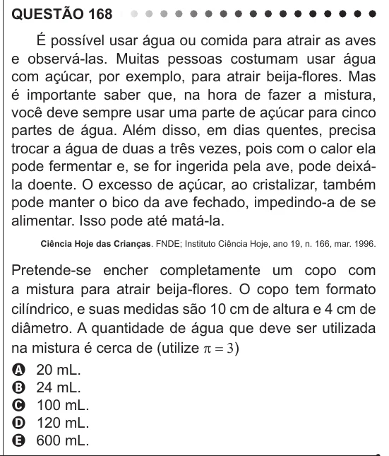

Texto extraído (pode conter ruído)

QUESTÃO 168  
É possível usar água ou comida para atrair as aves  
e observá-las. Muitas pessoas costumam usar água  
com açúcar, por exemplo, para atrair beija-flores. Mas  
é importante saber que, na hora de fazer a mistura,  
você deve sempre usar uma parte de açúcar para cinco  
partes de água. Além disso, em dias quentes, precisa  
trocar a água de duas a três vezes, pois com o calor ela  
pode fermentar e, se for ingerida pela ave, pode deixá-  
la doente. O excesso de açúcar, ao cristalizar, também  
pode manter o bico da ave fechado, impedindo-a de se  
alimentar. Isso pode até matá-la.  
Ciência Hoje das Crianças. FNDE; Instituto Ciência Hoje, ano 19, n. 166, mar. 1996.  
Pretende-se encher completamente um copo com  
a mistura para atrair beija-flores. O copo tem formato  
cilíndrico, e suas medidas são 10 cm de altura e 4 cm de  
diâmetro. A quantidade de água que deve ser utilizada  
na mistura é cerca de (utilize p = 3)  
A 20 mL.  
B 24 mL.  
C 100 mL.  
D 120 mL.  
E 600 mL.

