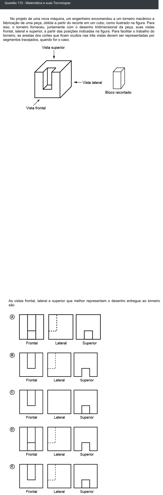

Texto extraído (pode conter ruído)

Questão 170 - Matemática e suas Tecnologias  
No projeto de uma nova máquina, um engenheiro encomendou a um torneiro mecânico a  
fabricação de uma peça, obtida a partir do recorte em um cubo, como ilustrado na figura. Para  
isso, o torneiro forneceu, juntamente com o desenho tridimensional da peça, suas vistas  
frontal, lateral e superior, a partir das posições indicadas na figura. Para facilitar o trabalho do  
torneiro, as arestas dos cortes que ficam ocultos nas três vistas devem ser representadas por  
segmentos tracejados, quando for o caso.  
As vistas frontal, lateral e superior que melhor representam o desenho entregue ao torneiro  
são  
A  
B  
C  
D  
E

