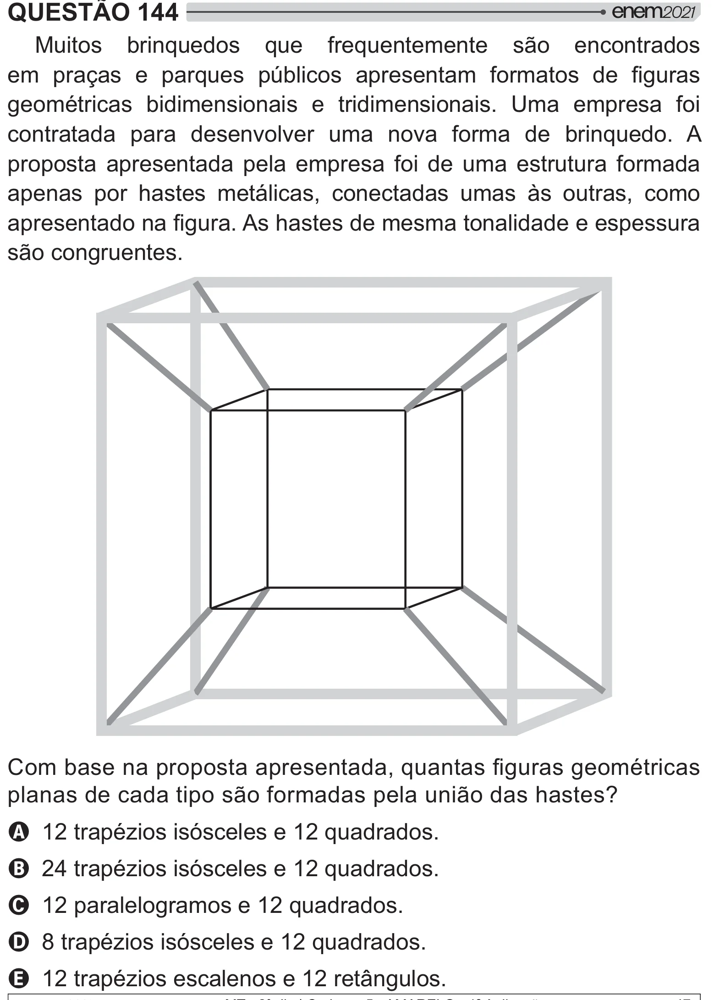

Texto extraído (pode conter ruído)

QUESTÃO 144  
Muitos brinquedos que frequentemente são encontrados  
 #=   #  
 #„y  #  
  >         
geométricas bidimensionais e tridimensionais. Uma empresa foi  
contratada para desenvolver uma nova forma de brinquedo. A  
proposta apresentada pela empresa foi de uma estrutura formada  
apenas por hastes metálicas, conectadas umas às outras, como  
#  
  ! $  
      #  
  
são congruentes.  
y ## #  
       <    
#   # [> #  [ $  
]  
A 12 trapézios isósceles e 12 quadrados.  
B 24 trapézios isósceles e 12 quadrados.  
C 12 paralelogramos e 12 quadrados.  
D 8 trapézios isósceles e 12 quadrados.  
E 12 trapézios escalenos e 12 retângulos.

