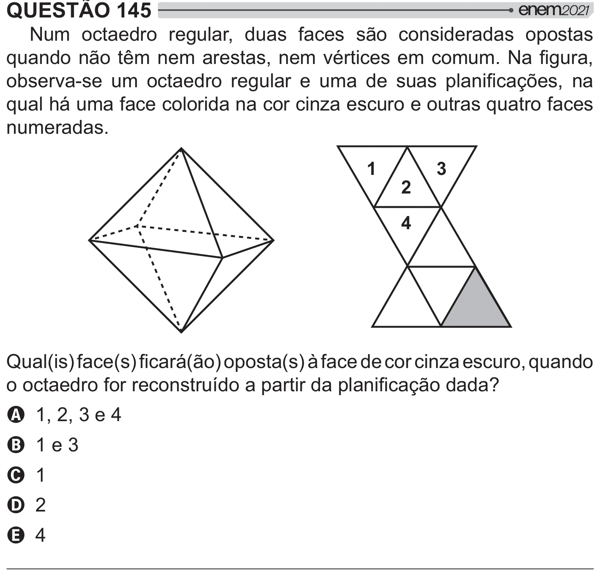

Texto extraído (pode conter ruído)

QUESTÃO 145  
Num octaedro regular, duas faces são consideradas opostas  
[ +    "<    !ˆ   
y "               #=    
qual há uma face colorida na cor cinza escuro e outras quatro faces  
numeradas.  
1  
3  
2  
4  
& J W> J W/J[W# J W¸>       
  >   {# #=[]  
A 1, 2, 3 e 4  
B 1 e 3  
C 1  
D 2  
E 4

