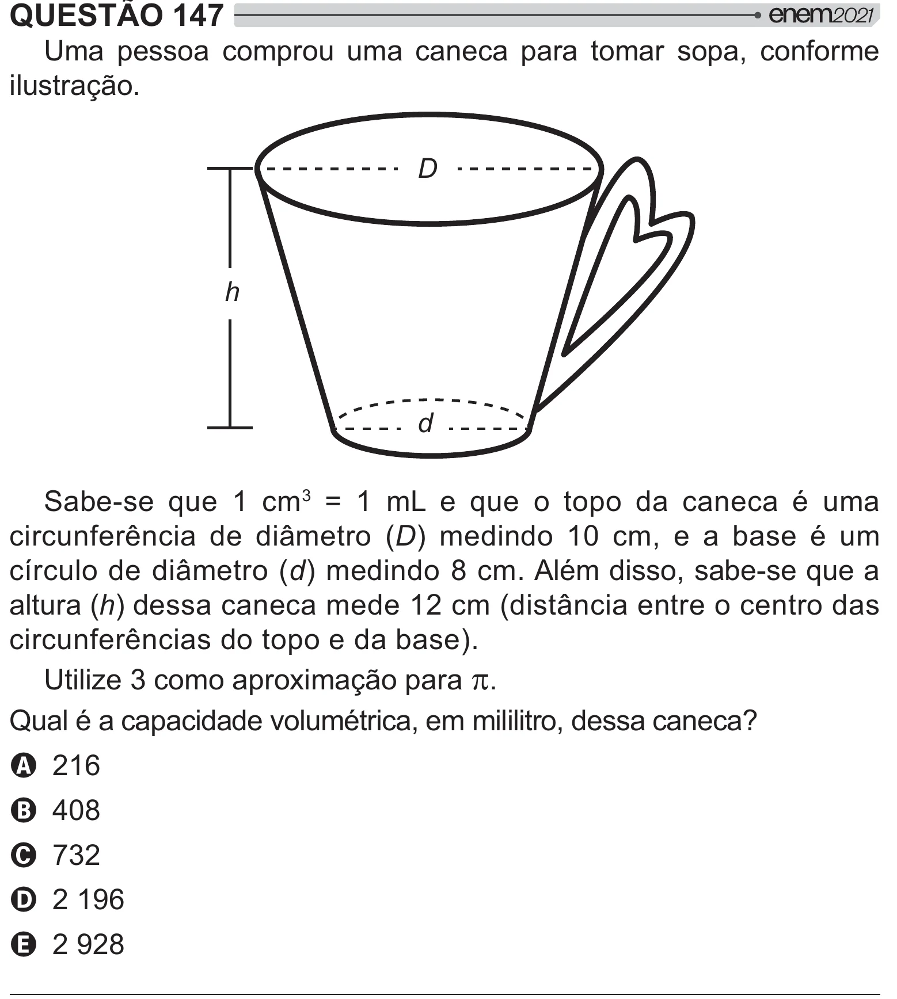

Texto extraído (pode conter ruído)

QUESTÃO 147  
Uma pessoa comprou uma caneca para tomar sopa, conforme  
ilustração.  
D  
h  
d  
Sabe-se que 1 cm ¹ = 1 mL e que o topo da caneca é uma  
circunferência de diâmetro (D) medindo 10 cm, e a base é um  
círculo de diâmetro (d) medindo 8 cm. Além disso, sabe-se que a  
altura (h) dessa caneca mede 12 cm (distância entre o centro das  
circunferências do topo e da base).  
Utilize 3 como aproximação para S .  
& <# " <     ]  
A 216  
B 408  
C 732  
D 2 196  
E 2 928

