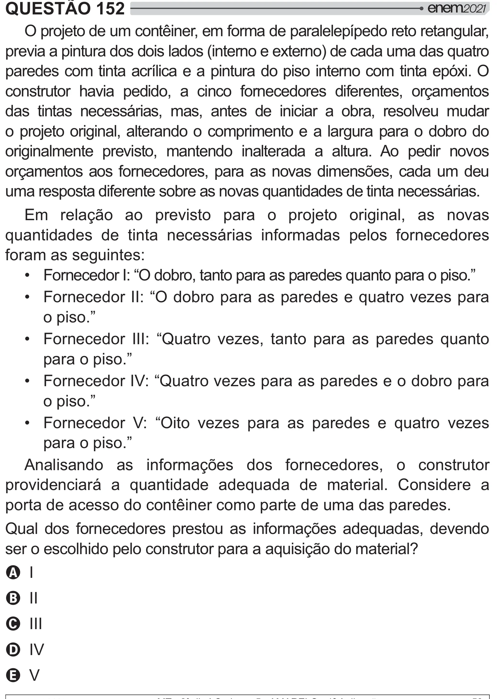

Texto extraído (pode conter ruído)

QUESTÃO 152  
O projeto de um contêiner, em forma de paralelepípedo reto retangular,  
previa a pintura dos dois lados (interno e externo) de cada uma das quatro  
paredes com tinta acrílica e a pintura do piso interno com tinta epóxi. O  
construtor havia pedido, a cinco fornecedores diferentes, orçamentos  
das tintas necessárias, mas, antes de iniciar a obra, resolveu mudar  
o projeto original, alterando o comprimento e a largura para o dobro do  
originalmente previsto, mantendo inalterada a altura. Ao pedir novos  
orçamentos aos fornecedores, para as novas dimensões, cada um deu  
uma resposta diferente sobre as novas quantidades de tinta necessárias.  
Em relação ao previsto para o projeto original, as novas  
quantidades de tinta necessárias informadas pelos fornecedores  
foram as seguintes:  
• Fornecedor I: “O dobro, tanto para as paredes quanto para o piso.”  
• Fornecedor II: “O dobro para as paredes e quatro vezes para  
o piso.”  
• Fornecedor III: “Quatro vezes, tanto para as paredes quanto  
para o piso.”  
• Fornecedor IV: “Quatro vezes para as paredes e o dobro para  
o piso.”  
• Fornecedor V: “Oito vezes para as paredes e quatro vezes  
para o piso.”  
Analisando as informações dos fornecedores, o construtor  
providenciará a quantidade adequada de material. Considere a  
porta de acesso do contêiner como parte de uma das paredes.  
Qual dos fornecedores prestou as informações adequadas, devendo  
 $#   #  =[ ]  
A I  
B II  
C III  
D IV  
E V

