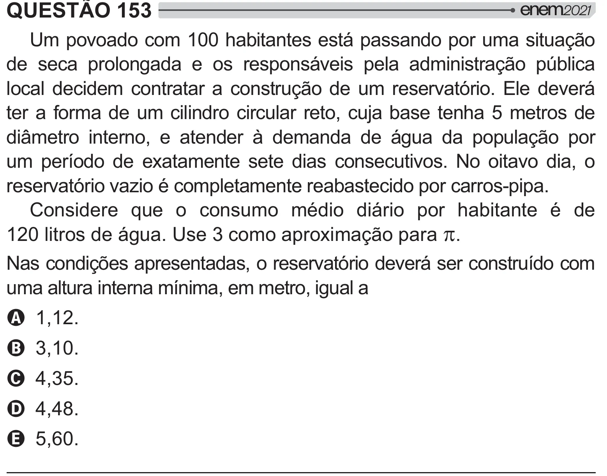

Texto extraído (pode conter ruído)

QUESTÃO 153  
Um povoado com 100 habitantes está passando por uma situação  
de seca prolongada e os responsáveis pela administração pública  
local decidem contratar a construção de um reservatório. Ele deverá  
ter a forma de um cilindro circular reto, cuja base tenha 5 metros de  
diâmetro interno, e atender à demanda de água da população por  
um período de exatamente sete dias consecutivos. No oitavo dia, o  
reservatório vazio é completamente reabastecido por carros-pipa.  
Considere que o consumo médio diário por habitante é de  
120 litros de água. Use 3 como aproximação para S .  
Nas condições apresentadas, o reservatório deverá ser construído com  
uma altura interna mínima, em metro, igual a  
A 1,12.  
B 3,10.  
C 4,35.  
D 4,48.  
E 5,60.

