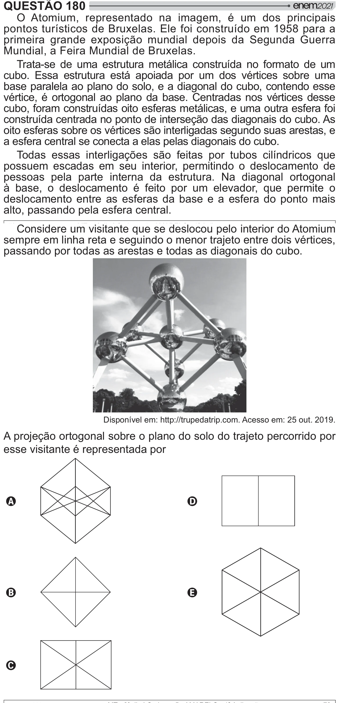

Texto extraído (pode conter ruído)

QUESTÃO 180  
O Atomium, representado na imagem, é um dos principais  
pontos turísticos de Bruxelas. Ele foi construído em 1958 para a  
primeira grande exposição mundial depois da Segunda Guerra  
Mundial, a Feira Mundial de Bruxelas.  
Trata-se de uma estrutura metálica construída no formato de um  
cubo. Essa estrutura está apoiada por um dos vértices sobre uma  
base paralela ao plano do solo, e a diagonal do cubo, contendo esse  
vértice, é ortogonal ao plano da base. Centradas nos vértices desse  
cubo, foram construídas oito esferas metálicas, e uma outra esfera foi  
construída centrada no ponto de interseção das diagonais do cubo. As  
oito esferas sobre os vértices são interligadas segundo suas arestas, e  
a esfera central se conecta a elas pelas diagonais do cubo.  
Todas essas interligações são feitas por tubos cilíndricos que  
possuem escadas em seu interior, permitindo o deslocamento de  
pessoas pela parte interna da estrutura. Na diagonal ortogonal  
à base, o deslocamento é feito por um elevador, que permite o  
deslocamento entre as esferas da base e a esfera do ponto mais  
alto, passando pela esfera central.  
Considere um visitante que se deslocou pelo interior do Atomium  
sempre em linha reta e seguindo o menor trajeto entre dois vértices,  
passando por todas as arestas e todas as diagonais do cubo.  
Disponível em: http://trupedatrip.com. Acesso em: 25 out. 2019.  
A projeção ortogonal sobre o plano do solo do trajeto percorrido por  
esse visitante é representada por  
A  
D  
B  
E  
C

