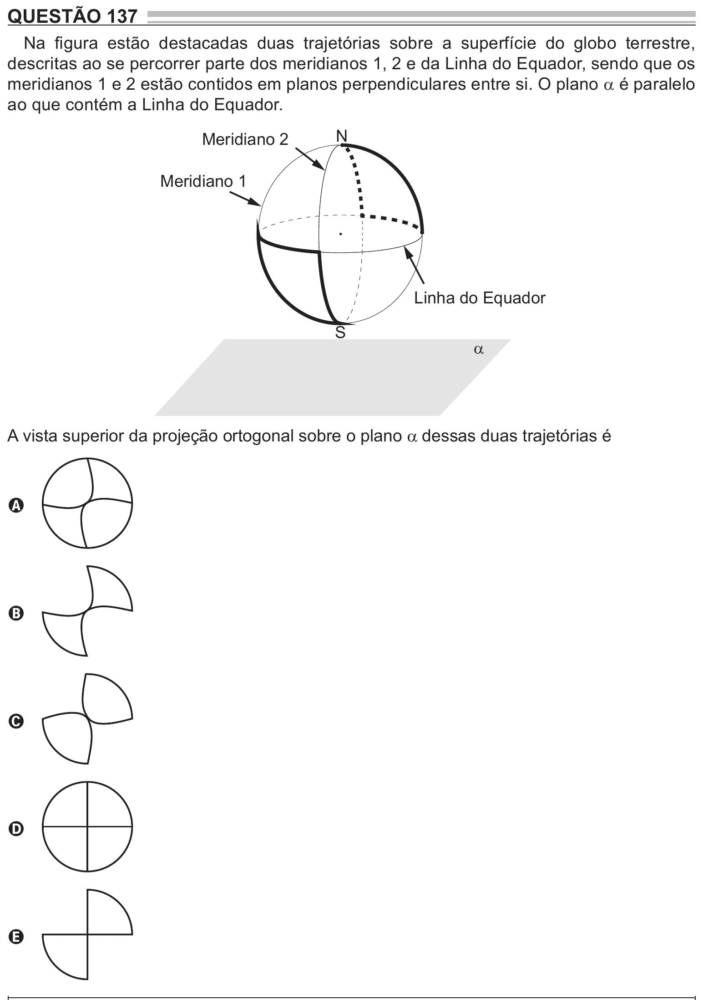

Texto extraído (pode conter ruído)

QUESTÃO 137  
Na figura estão destacadas duas trajetórias sobre a superfície do globo terrestre,  
descritas ao se percorrer parte dos meridianos 1, 2 e da Linha do Equador, sendo que os  
meridianos 1 e 2 estão contidos em planos perpendiculares entre si. O plano α é paralelo  
ao que contém a Linha do Equador.  
N  
Meridiano 2  
Meridiano 1  
Linha do Equador  
S  
α  
A vista superior da projeção ortogonal sobre o plano α dessas duas trajetórias é  
A  
B  
C  
D  
E

