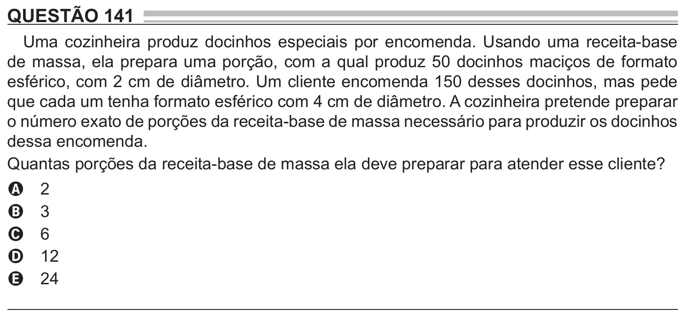

Texto extraído (pode conter ruído)

QUESTÃO 141  
Uma cozinheira produz docinhos especiais por encomenda. Usando uma receita-base  
de massa, ela prepara uma porção, com a qual produz 50 docinhos maciços de formato  
esférico, com 2 cm de diâmetro. Um cliente encomenda 150 desses docinhos, mas pede  
que cada um tenha formato esférico com 4 cm de diâmetro. A cozinheira pretende preparar  
o número exato de porções da receita-base de massa necessário para produzir os docinhos  
dessa encomenda.  
Quantas porções da receita-base de massa ela deve preparar para atender esse cliente?  
2  
A  
3  
B  
6  
C  
12  
D  
24  
E

