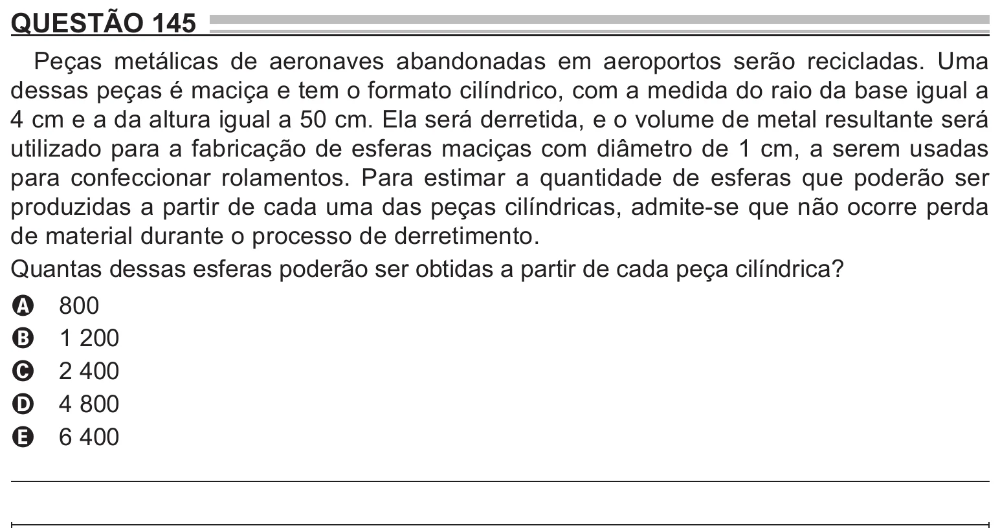

Texto extraído (pode conter ruído)

QUESTÃO 145  
Peças metálicas de aeronaves abandonadas em aeroportos serão recicladas. Uma  
dessas peças é maciça e tem o formato cilíndrico, com a medida do raio da base igual a  
4 cm e a da altura igual a 50 cm. Ela será derretida, e o volume de metal resultante será  
utilizado para a fabricação de esferas maciças com diâmetro de 1 cm, a serem usadas  
para confeccionar rolamentos. Para estimar a quantidade de esferas que poderão ser  
produzidas a partir de cada uma das peças cilíndricas, admite-se que não ocorre perda  
de material durante o processo de derretimento.  
Quantas dessas esferas poderão ser obtidas a partir de cada peça cilíndrica?  
800  
A  
1 200  
B  
2 400  
C  
4 800  
D  
6 400  
E

