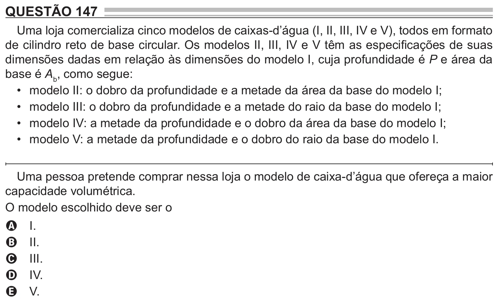

Texto extraído (pode conter ruído)

QUESTÃO 147  
Uma loja comercializa cinco modelos de caixas-d’água (I, II, III, IV e V), todos em formato  
de cilindro reto de base circular. Os modelos II, III, IV e V têm as especificações de suas  
dimensões dadas em relação às dimensões do modelo I, cuja profundidade é P e área da  
base é A b , como segue:  
• modelo II: o dobro da profundidade e a metade da área da base do modelo I;  
• modelo III: o dobro da profundidade e a metade do raio da base do modelo I;  
• modelo IV: a metade da profundidade e o dobro da área da base do modelo I;  
• modelo V: a metade da profundidade e o dobro do raio da base do modelo I.  
Uma pessoa pretende comprar nessa loja o modelo de caixa-d’água que ofereça a maior  
capacidade volumétrica.  
O modelo escolhido deve ser o  
I.  
A  
II.  
B  
III.  
C  
IV.  
D  
V.  
E

