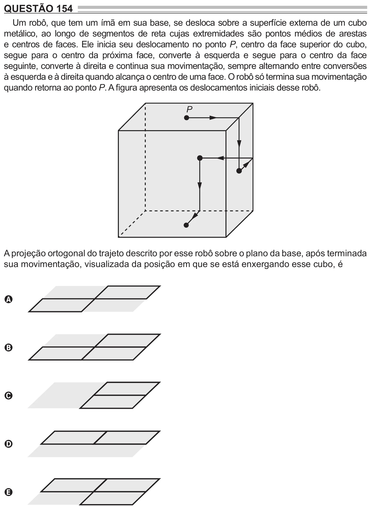

Texto extraído (pode conter ruído)

QUESTÃO 154  
Um robô, que tem um ímã em sua base, se desloca sobre a superfície externa de um cubo  
metálico, ao longo de segmentos de reta cujas extremidades são pontos médios de arestas  
e centros de faces. Ele inicia seu deslocamento no ponto P, centro da face superior do cubo,  
segue para o centro da próxima face, converte à esquerda e segue para o centro da face  
seguinte, converte à direita e continua sua movimentação, sempre alternando entre conversões  
à esquerda e à direita quando alcança o centro de uma face. O robô só termina sua movimentação  
quando retorna ao ponto P. A figura apresenta os deslocamentos iniciais desse robô.  
P  
A projeção ortogonal do trajeto descrito por esse robô sobre o plano da base, após terminada  
sua movimentação, visualizada da posição em que se está enxergando esse cubo, é  
A  
B  
C  
D  
E

