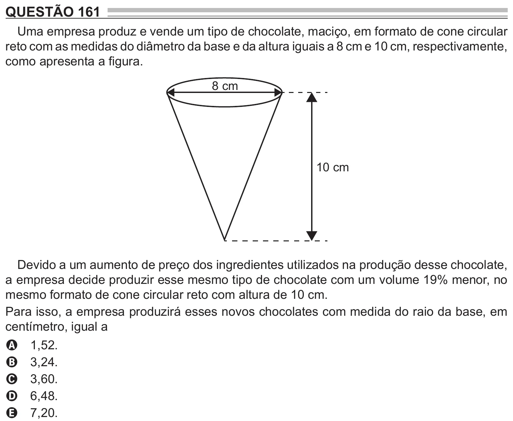

Texto extraído (pode conter ruído)

QUESTÃO 161  
Uma empresa produz e vende um tipo de chocolate, maciço, em formato de cone circular  
reto com as medidas do diâmetro da base e da altura iguais a 8 cm e 10 cm, respectivamente,  
como apresenta a figura.  
8 cm  
10 cm  
Devido a um aumento de preço dos ingredientes utilizados na produção desse chocolate,  
a empresa decide produzir esse mesmo tipo de chocolate com um volume 19% menor, no  
mesmo formato de cone circular reto com altura de 10 cm.  
Para isso, a empresa produzirá esses novos chocolates com medida do raio da base, em  
centímetro, igual a  
1,52.  
A  
3,24.  
B  
3,60.  
C  
6,48.  
D  
7,20.  
E

