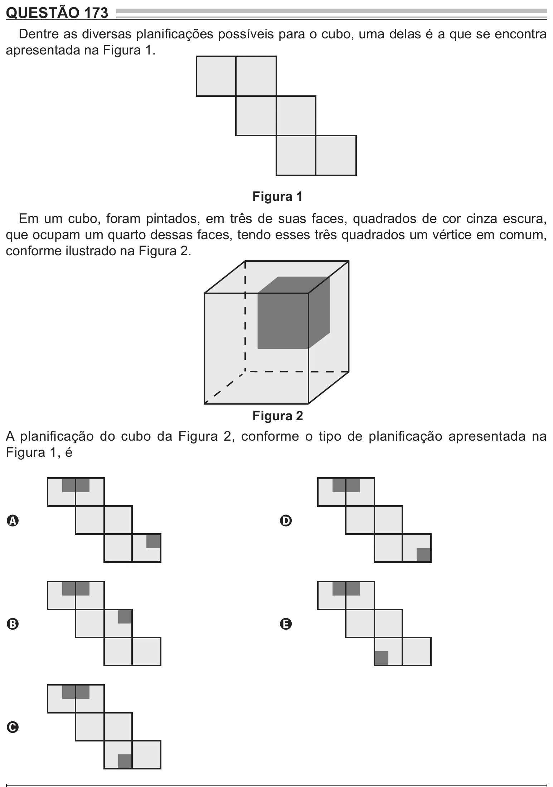

Texto extraído (pode conter ruído)

QUESTÃO 173  
Dentre as diversas planificações possíveis para o cubo, uma delas é a que se encontra  
apresentada na Figura 1.  
Figura 1  
Em um cubo, foram pintados, em três de suas faces, quadrados de cor cinza escura,  
que ocupam um quarto dessas faces, tendo esses três quadrados um vértice em comum,  
conforme ilustrado na Figura 2.  
Figura 2  
A planificação do cubo da Figura 2, conforme o tipo de planificação apresentada na  
Figura 1, é  
A  
D  
B  
E  
C

