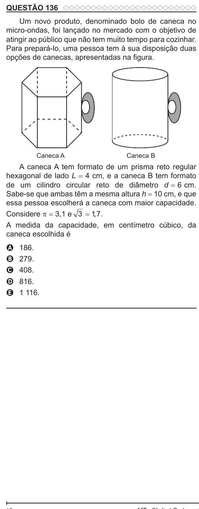

Texto extraído (pode conter ruído)

QUESTÃO 136  
Um novo produto, denominado bolo de caneca no  
micro-ondas, foi lançado no mercado com o objetivo de  
atingir ao público que não tem muito tempo para cozinhar.  
Para prepará-lo, uma pessoa tem à sua disposição duas  
opções de canecas, apresentadas na figura.  
Caneca A  
Caneca B  
A caneca A tem formato de um prisma reto regular  
hexagonal de lado L = 4 cm, e a caneca B tem formato  
de um cilindro circular reto de diâmetro d = 6 cm.  
Sabe-se que ambas têm a mesma altura h = 10 cm, e que  
essa pessoa escolherá a caneca com maior capacidade.  
Considere π = 3,1 e 3 = 1 , 7 .  
A medida da capacidade, em centímetro cúbico, da  
caneca escolhida é  
186.  
A  
279.  
B  
C  
408.  
816.  
D  
1 116.  
E

