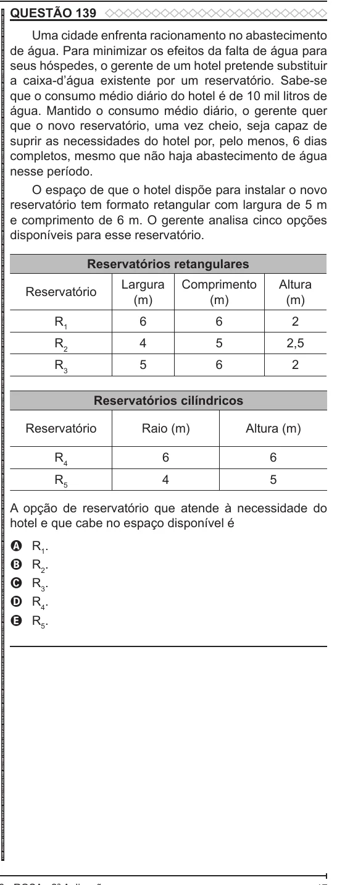

Texto extraído (pode conter ruído)

QUESTÃO 139  
ENEM 2022 ENEM 2022 ENEM 2022 ENEM 2022 ENEM 2022 ENEM 2022 ENEM 2022 ENEM 2022 ENEM 2022 ENEM 2022 ENEM 2022 ENEM 2022 ENEM 2022 ENEM 2022 ENEM 2022 ENEM 2022 ENEM 2022 ENEM 2022 ENEM 2022 ENEM 2022 ENEM 2022 ENEM 2022 ENEM 2022 ENEM 2022 ENEM 2022 ENEM 2022 ENEM 2022 ENEM 2022 ENEM 2022 ENEM 2022 ENEM 2022 ENEM 2022 ENEM 2022 ENEM 2022 ENEM 2022 ENEM 2022 ENEM 2022 ENEM 2022 ENEM 2022 ENEM 2022 ENEM 2022 ENEM 2022 ENEM 2022 ENEM 2022 ENEM 2022 ENEM 2022 ENEM 2022 ENEM 2022 ENEM 2022 ENEM 2022 ENEM 2022 ENEM 2022 ENEM 2022 ENEM 2022 ENEM 2022 ENEM 2022 ENEM 2022 ENEM 2022 ENEM 2022 ENEM 2022 ENEM 2022 ENEM 2022 ENEM 2022  
Uma cidade enfrenta racionamento no abastecimento  
de água. Para minimizar os efeitos da falta de água para  
seus hóspedes, o gerente de um hotel pretende substituir  
a caixa-d’água existente por um reservatório. Sabe-se  
que o consumo médio diário do hotel é de 10 mil litros de  
água. Mantido o consumo médio diário, o gerente quer  
que o novo reservatório, uma vez cheio, seja capaz de  
suprir as necessidades do hotel por, pelo menos, 6 dias  
completos, mesmo que não haja abastecimento de água  
nesse período.  
O espaço de que o hotel dispõe para instalar o novo  
reservatório tem formato retangular com largura de 5 m  
e comprimento de 6 m. O gerente analisa cinco opções  
disponíveis para esse reservatório.  
Reservatórios retangulares  
Largura  
Comprimento  
Altura  
Reservatório  
(m)  
(m)  
(m)  
R 1  
6  
6  
2  
R 2  
4  
5  
2,5  
R 3  
5  
6  
2  
Reservatórios cilíndricos  
Reservatório  
Raio (m)  
Altura (m)  
R 4  
6  
6  
R 5  
4  
5  
A opção de reservatório que atende à necessidade do  
hotel e que cabe no espaço disponível é  
A  
R 1 .  
R 2 .  
B  
R 3 .  
C  
R 4 .  
D  
R 5 .  
E

