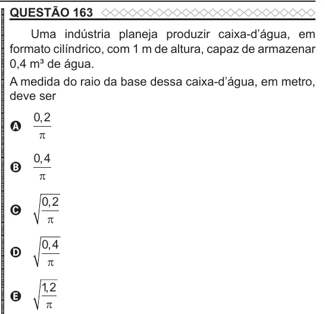

Texto extraído (pode conter ruído)

QUESTÃO 163  
Uma indústria planeja produzir caixa-d’água, em  
formato cilíndrico, com 1 m de altura, capaz de armazenar  
0,4 m³ de água.  
A medida do raio da base dessa caixa-d’água, em metro,  
deve ser  
0 , 2  
A  
π  
0 , 4  
B  
π  
0 , 2  
C  
π  
0 , 4  
D  
π  
1 , 2  
E  
π

