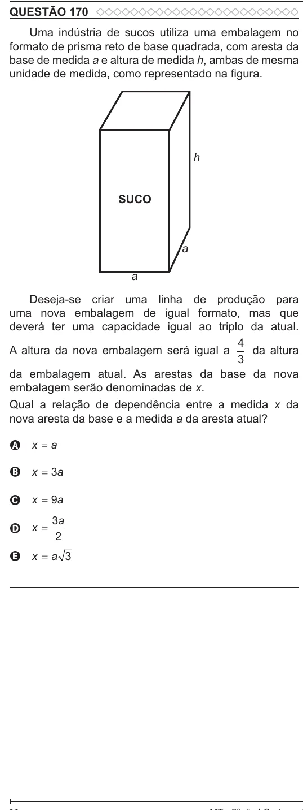

Texto extraído (pode conter ruído)

QUESTÃO 170  
Uma indústria de sucos utiliza uma embalagem no  
formato de prisma reto de base quadrada, com aresta da  
base de medida a e altura de medida h, ambas de mesma  
unidade de medida, como representado na figura.  
h  
SUCO  
a  
a  
Deseja-se criar uma linha de produção para  
uma nova embalagem de igual formato, mas que  
deverá ter uma capacidade igual ao triplo da atual.  
4  
A altura da nova embalagem será igual a  
da altura  
3  
da embalagem atual. As arestas da base da nova  
embalagem serão denominadas de x.  
Qual a relação de dependência entre a medida x da  
nova aresta da base e a medida a da aresta atual?  
A x = a  
B x = 3a  
C x = 9a  
3 a  
D x =  
2  
E x = a 3

