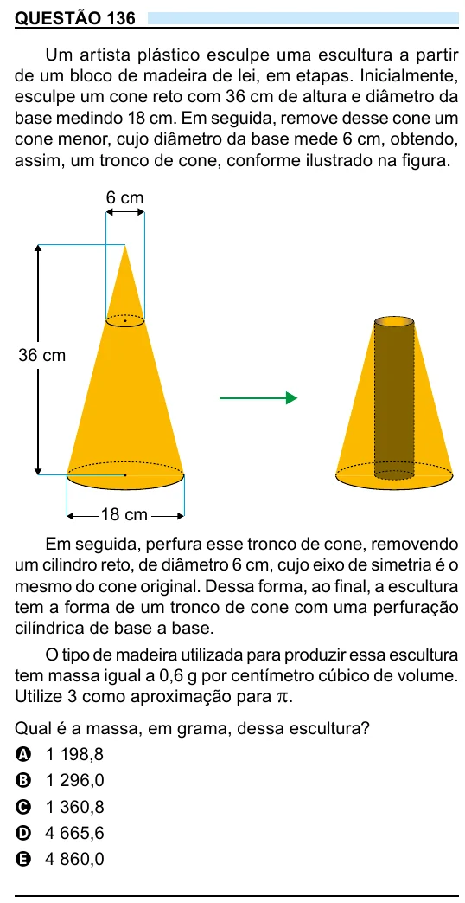

Texto extraído (pode conter ruído)

QUESTÃO 136  
Um artista plástico esculpe uma escultura a partir  
de um bloco de madeira de lei, em etapas. Inicialmente,  
esculpe um cone reto com 36 cm de altura e diâmetro da  
base medindo 18 cm. Em seguida, remove desse cone um  
cone menor, cujo diâmetro da base mede 6 cm, obtendo,  
assim, um tronco de cone, conforme ilustrado na figura.  
6 cm  
36 cm  
18 cm  
Em seguida, perfura esse tronco de cone, removendo  
um cilindro reto, de diâmetro 6 cm, cujo eixo de simetria é o  
mesmo do cone original. Dessa forma, ao final, a escultura  
tem a forma de um tronco de cone com uma perfuração  
cilíndrica de base a base.  
O tipo de madeira utilizada para produzir essa escultura  
tem massa igual a 0,6 g por centímetro cúbico de volume.  
Utilize 3 como aproximação para π .  
Qual é a massa, em grama, dessa escultura?  
A 1 198,8  
B 1 296,0  
C 1 360,8  
D 4 665,6  
E 4 860,0

