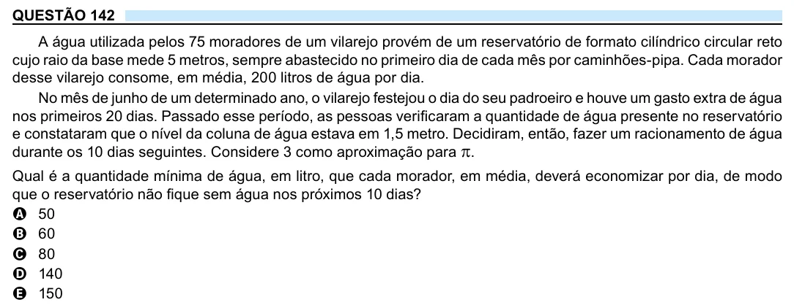

Texto extraído (pode conter ruído)

QUESTÃO 142  
A água utilizada pelos 75 moradores de um vilarejo provém de um reservatório de formato cilíndrico circular reto  
cujo raio da base mede 5 metros, sempre abastecido no primeiro dia de cada mês por caminhões-pipa. Cada morador  
desse vilarejo consome, em média, 200 litros de água por dia.  
No mês de junho de um determinado ano, o vilarejo festejou o dia do seu padroeiro e houve um gasto extra de água  
nos primeiros 20 dias. Passado esse período, as pessoas verificaram a quantidade de água presente no reservatório  
e constataram que o nível da coluna de água estava em 1,5 metro. Decidiram, então, fazer um racionamento de água  
durante os 10 dias seguintes. Considere 3 como aproximação para p .  
Qual é a quantidade mínima de água, em litro, que cada morador, em média, deverá economizar por dia, de modo  
que o reservatório não fique sem água nos próximos 10 dias?  
A 50  
B 60  
C 80  
D 140  
E 150

