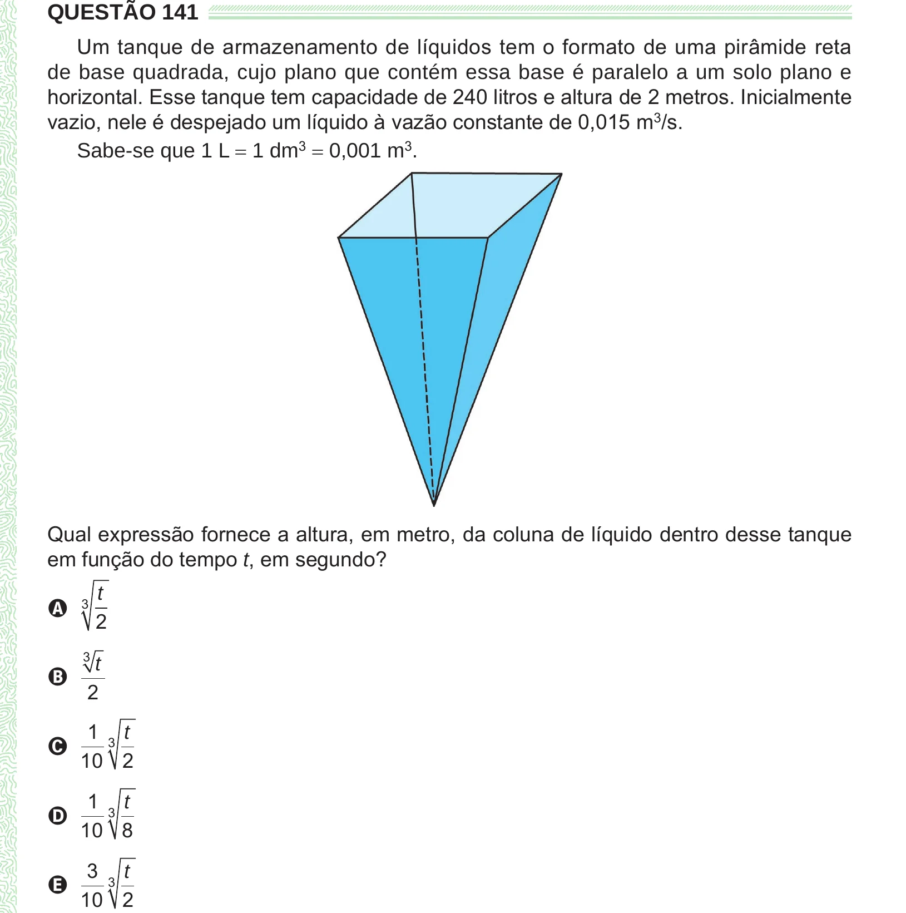

Texto extraído (pode conter ruído)

QUESTÃO 141  
Um tanque de armazenamento de líquidos tem o formato de uma pirâmide reta  
de base quadrada, cujo plano que contém essa base é paralelo a um solo plano e  
horizontal. Esse tanque tem capacidade de 240 litros e altura de 2 metros. Inicialmente  
vazio, nele é despejado um líquido à vazão constante de 0,015 m 3 /s.  
Sabe-se que 1 L = 1 dm 3 = 0,001 m 3 .  
Qual expressão fornece a altura, em metro, da coluna de líquido dentro desse tanque  
em função do tempo t, em segundo?  
t  
A 3  
2  
3  
t  
B  
2  
1 3 t  
C  
10 2  
1 3 t  
D  
10 8  
3 3 t  
E  
10 2

