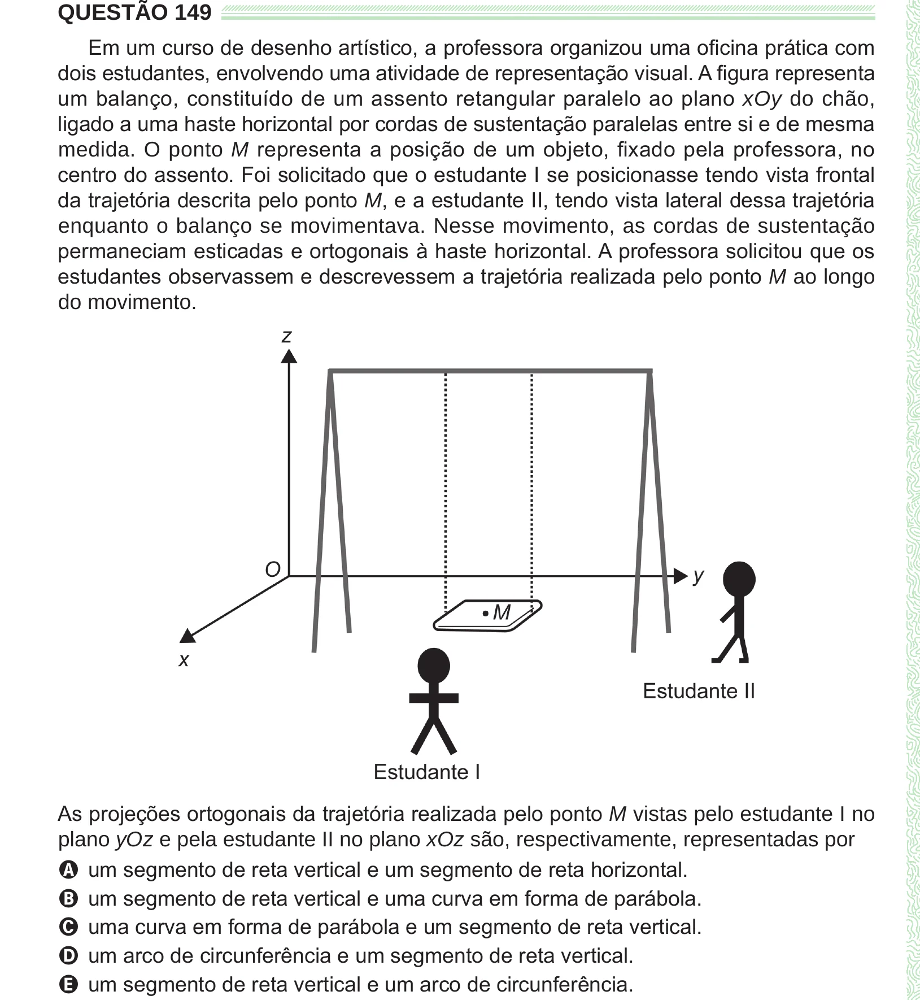

Texto extraído (pode conter ruído)

QUESTÃO 149  
Em um curso de desenho artístico, a professora organizou uma oficina prática com  
dois estudantes, envolvendo uma atividade de representação visual. A figura representa  
um balanço, constituído de um assento retangular paralelo ao plano xOy do chão,  
ligado a uma haste horizontal por cordas de sustentação paralelas entre si e de mesma  
medida. O ponto M representa a posição de um objeto, fixado pela professora, no  
centro do assento. Foi solicitado que o estudante I se posicionasse tendo vista frontal  
da trajetória descrita pelo ponto M, e a estudante II, tendo vista lateral dessa trajetória  
enquanto o balanço se movimentava. Nesse movimento, as cordas de sustentação  
permaneciam esticadas e ortogonais à haste horizontal. A professora solicitou que os  
estudantes observassem e descrevessem a trajetória realizada pelo ponto M ao longo  
do movimento.  
As projeções ortogonais da trajetória realizada pelo ponto M vistas pelo estudante I no  
plano yOz e pela estudante II no plano xOz são, respectivamente, representadas por  
A um segmento de reta vertical e um segmento de reta horizontal.  
B um segmento de reta vertical e uma curva em forma de parábola.  
C uma curva em forma de parábola e um segmento de reta vertical.  
D um arco de circunferência e um segmento de reta vertical.  
E um segmento de reta vertical e um arco de circunferência.

