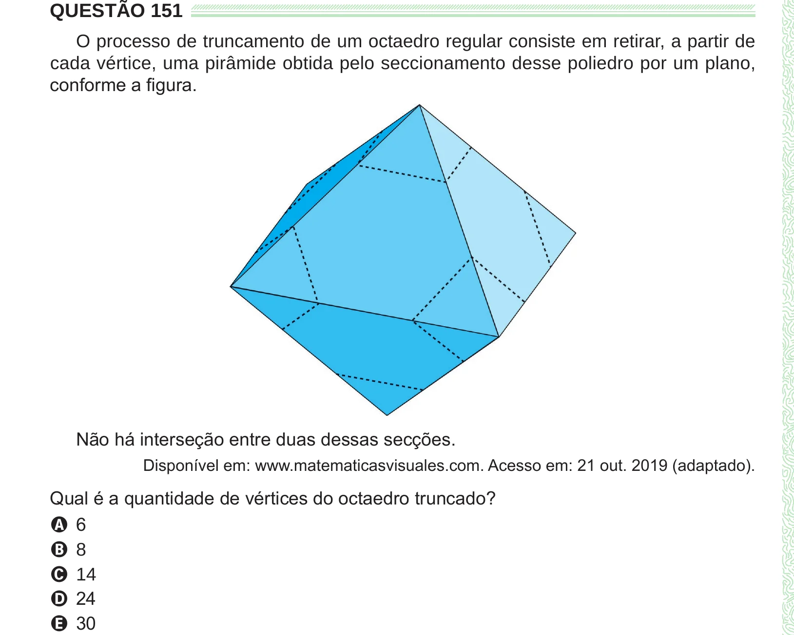

Texto extraído (pode conter ruído)

QUESTÃO 151  
O processo de truncamento de um octaedro regular consiste em retirar, a partir de  
cada vértice, uma pirâmide obtida pelo seccionamento desse poliedro por um plano,  
conforme a figura.  
Não há interseção entre duas dessas secções.  
Disponível em: www.matematicasvisuales.com. Acesso em: 21 out. 2019 (adaptado).  
Qual é a quantidade de vértices do octaedro truncado?  
A 6  
B 8  
C 14  
D 24  
E 30

