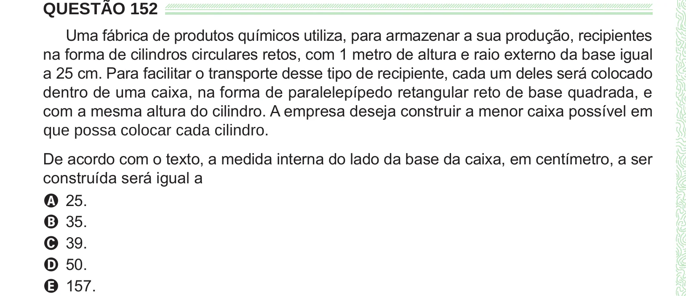

Texto extraído (pode conter ruído)

QUESTÃO 152  
Uma fábrica de produtos químicos utiliza, para armazenar a sua produção, recipientes  
na forma de cilindros circulares retos, com 1 metro de altura e raio externo da base igual  
a 25 cm. Para facilitar o transporte desse tipo de recipiente, cada um deles será colocado  
dentro de uma caixa, na forma de paralelepípedo retangular reto de base quadrada, e  
com a mesma altura do cilindro. A empresa deseja construir a menor caixa possível em  
que possa colocar cada cilindro.  
De acordo com o texto, a medida interna do lado da base da caixa, em centímetro, a ser  
construída será igual a  
A 25.  
B 35.  
C 39.  
D 50.  
E 157.

