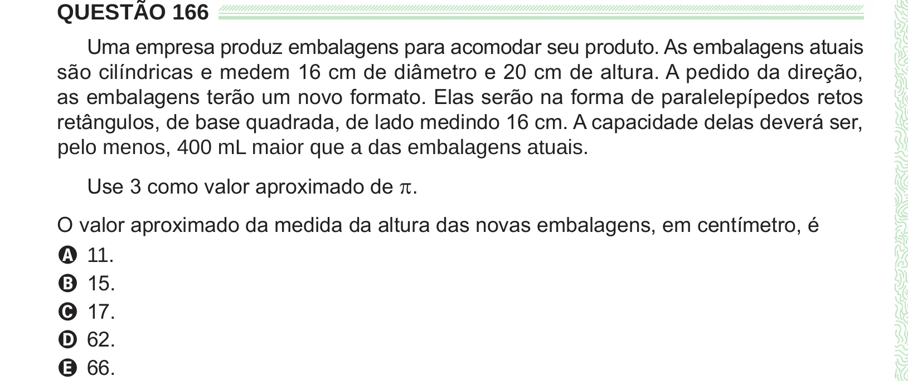

Texto extraído (pode conter ruído)

QUESTÃO 166  
Uma empresa produz embalagens para acomodar seu produto. As embalagens atuais  
são cilíndricas e medem 16 cm de diâmetro e 20 cm de altura. A pedido da direção,  
as embalagens terão um novo formato. Elas serão na forma de paralelepípedos retos  
retângulos, de base quadrada, de lado medindo 16 cm. A capacidade delas deverá ser,  
pelo menos, 400 mL maior que a das embalagens atuais.  
Use 3 como valor aproximado de π .  
O valor aproximado da medida da altura das novas embalagens, em centímetro, é  
A 11.  
B 15.  
C 17.  
D 62.  
E 66.

