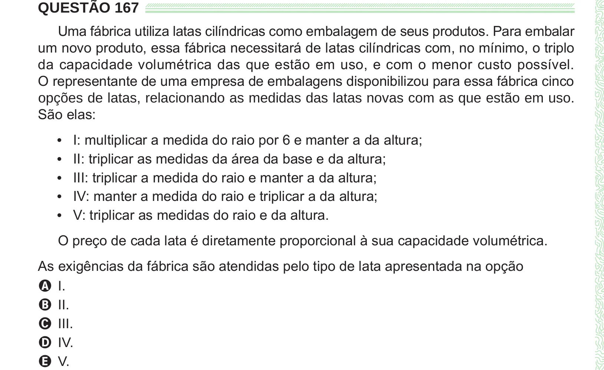

Texto extraído (pode conter ruído)

QUESTÃO 167  
Uma fábrica utiliza latas cilíndricas como embalagem de seus produtos. Para embalar  
um novo produto, essa fábrica necessitará de latas cilíndricas com, no mínimo, o triplo  
da capacidade volumétrica das que estão em uso, e com o menor custo possível.  
O representante de uma empresa de embalagens disponibilizou para essa fábrica cinco  
opções de latas, relacionando as medidas das latas novas com as que estão em uso.  
São elas:  
I: multiplicar a medida do raio por 6 e manter a da altura;  
•  
II: triplicar as medidas da área da base e da altura;  
•  
III: triplicar a medida do raio e manter a da altura;  
•  
IV: manter a medida do raio e triplicar a da altura;  
•  
V: triplicar as medidas do raio e da altura.  
•  
O preço de cada lata é diretamente proporcional à sua capacidade volumétrica.  
As exigências da fábrica são atendidas pelo tipo de lata apresentada na opção  
A I.  
B II.  
C III.  
D IV.  
E V.

